# Rancangan Database dan Alur SiDaya

Dokumen ini menetapkan tabel yang dibutuhkan, nama Indonesianya, dan alur tiap use case. Cakupannya hanya **Admin Dinas Sosial, LKS, dan pengunjung publik**. PSM, Karang Taruna, dan PUB tidak dibuat.

Semua diagram memakai Mermaid. Salin isi blok `mermaid` ke [mermaid.live](https://mermaid.live) untuk melihat atau mengunduhnya.

## 1. Ringkasan keputusan

| Hal | Keputusan |
| --- | --- |
| Database aplikasi | `sidaya` |
| Database pengujian | `sidaya_uji`. Tes tidak boleh berjalan di database aplikasi. |
| Mesin | MySQL/MariaDB, `utf8mb4` |
| Nama tabel | Bahasa Indonesia, huruf kecil, `snake_case`, bentuk tunggal |
| Nama kolom | Bahasa Indonesia, kecuali kolom bawaan Laravel pada tabel `notifikasi` dan `sesi` (bagian 7) |
| Jumlah tabel | 13 tabel, ditambah `migrations` milik Laravel |
| Zona waktu | `Asia/Makassar` (WITA) |

Rancangan ini berangkat dari skema project sumber (`D:\PKL\SiDaya`), lalu disederhanakan: kolom khusus pilar lain dan kolom fitur yang sudah pensiun tidak dibawa. Perbedaannya tercatat di bagian 8.

## 2. Aktor dan use case

| Aktor | Peran di sistem |
| --- | --- |
| **Pengunjung** | Membaca halaman publik dan mengirim pendaftaran LKS, tanpa akun |
| **LKS** | Pengurus lembaga yang mengelola data lembaganya sendiri (`pengguna.peran = lks`) |
| **Admin** | Petugas Dinas Sosial yang meninjau, membaca lintas lembaga, dan mengelola akun (`pengguna.peran = admin`) |

Mermaid tidak punya jenis diagram use case khusus, jadi diagram ini memakai `flowchart`.

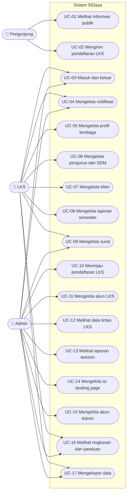

### Use case dan tabelnya

| Kode | Use case | Aktor | Tabel | Halaman Tahap 1 |
| --- | --- | --- | --- | --- |
| UC-01 | Melihat informasi publik | Pengunjung | `isi_landing`, `berkas_tersimpan` | `/`, `/profil.html`, `/pilar-sosial.html`, `/pilar/lks.html`, `/kontak.html` |
| UC-02 | Mengirim pendaftaran LKS | Pengunjung | `pendaftaran_lks`, `berkas_pendaftaran`, `berkas_tersimpan`, `potongan_berkas`, `notifikasi` | `/pilar/pendaftaran-lks.html` |
| UC-03 | Masuk dan keluar | LKS, Admin | `pengguna`, `sesi` | `/login` |
| UC-04 | Mengelola notifikasi | LKS, Admin | `notifikasi` | `/{peran}/notifications` |
| UC-05 | Mengelola profil lembaga, logo, koordinat | LKS | `lembaga`, `berkas_tersimpan` | `/lks/profile` |
| UC-06 | Mengelola pengurus dan SDM | LKS | `pengurus_lks`, `berkas_tersimpan` | `/lks/members` |
| UC-07 | Mengelola klien dan rekap penghuni | LKS | `klien_lks` | `/lks/occupancy`, `/lks/new-resident` |
| UC-08 | Mengelola laporan semester | LKS | `laporan_semester`, `berkas_tersimpan`, `notifikasi` | `/lks/reports`, `/lks/drafts` |
| UC-09 | Mengelola surat | LKS, Admin | `surat_lks`, `berkas_tersimpan`, `notifikasi` | `/lks/letters`, `/admin/letters/lks` |
| UC-10 | Meninjau pendaftaran LKS | Admin | `pendaftaran_lks`, `berkas_pendaftaran`, `lembaga` | `/admin/registrations/lks` |
| UC-11 | Membuat akun, reset sandi, mencabut akun LKS | Admin | `pengguna`, `lembaga`, `sesi`, `notifikasi` | `/admin/partner-accounts` |
| UC-12 | Melihat data lembaga, pengurus, dan klien | Admin | `lembaga`, `pengurus_lks`, `klien_lks` | `/admin/organizations/lks`, `/admin/occupancy` |
| UC-13 | Melihat dan mengunduh laporan terkirim | Admin | `laporan_semester`, `berkas_tersimpan` | `/admin/reports/lks` |
| UC-14 | Mengelola isi landing page | Admin | `isi_landing`, `berkas_tersimpan` | `/admin/landing-content` |
| UC-15 | Mengubah profil dan sandi Admin | Admin | `pengguna`, `sesi` | `/admin/account`, `/account/password` |
| UC-16 | Melihat ringkasan dan panduan | LKS, Admin | Membaca beberapa tabel; panduan tanpa tabel | `/{peran}/overview`, `/{peran}/guide` |
| UC-17 | Mengekspor Excel dan PDF | LKS, Admin | Membaca tabel terkait | Tombol unduh tiap halaman |

## 3. Daftar tabel

| No | Tabel | Isi | Tabel sumber | Class dummy yang diganti |
| --- | --- | --- | --- | --- |
| 1 | `pengguna` | Akun masuk Admin dan LKS | `users` | `DemoAccounts`, `DemoAdminAccount`, `DemoShell` |
| 2 | `lembaga` | Profil LKS | `organizations` | `DemoOrganizations` |
| 3 | `pendaftaran_lks` | Kiriman formulir pendaftaran publik | `partner_registrations` | `DemoRegistrations` |
| 4 | `berkas_pendaftaran` | Daftar 16 dokumen tiap pendaftaran | `partner_registration_files` | `DemoRegistrations` |
| 5 | `pengurus_lks` | Pengurus dan SDM lembaga | `organization_members` | `DemoMembers` |
| 6 | `klien_lks` | Klien atau warga binaan | `lks_clients` | `DemoClients` |
| 7 | `laporan_semester` | Laporan semester lembaga | `quarterly_reports` | `DemoReports` |
| 8 | `surat_lks` | Surat antara Dinas dan LKS | `lks_letters` | `DemoLetters` |
| 9 | `berkas_tersimpan` | Metadata semua berkas | `stored_files` | Lampiran dummy |
| 10 | `potongan_berkas` | Isi berkas, per potongan 48 KiB | `stored_file_chunks` | Tidak ada |
| 11 | `isi_landing` | Isian landing page yang diubah Admin | `landing_contents` | `DemoLanding`, `DemoLandingContents` |
| 12 | `notifikasi` | Notifikasi per pengguna | `notifications` | `DemoNotifications` |
| 13 | `sesi` | Sesi masuk | `sessions` | `DemoState` |

**Data yang tidak perlu tabel:**

- Daftar kecamatan dan kelurahan tetap di berkas config, menggantikan `DemoRegions`.
- Pilihan isian formulir tetap di kode, seperti `DemoClientSchema` dan `lks-rules.js`.
- Daftar slot landing page tetap dibaca dari Blade oleh `LandingRegistry`.
- `cache`, `jobs`, dan `password_reset_tokens` tidak dibuat. `.env` sudah memakai cache `file` dan antrean `sync`, dan akun tidak punya fitur lupa sandi lewat email.

## 4. Diagram relasi (ERD)

Diagram ini hanya memuat kolom kunci. Kolom lengkapnya ada di bagian 5.

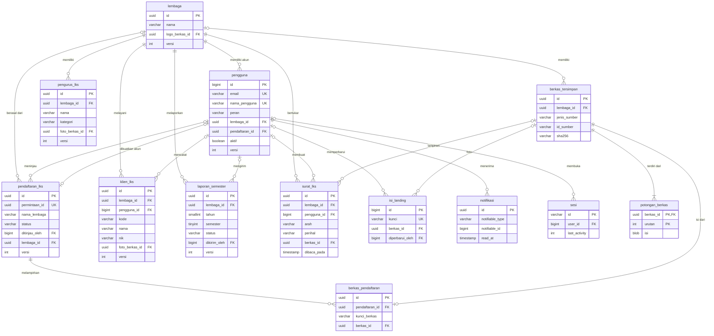

## 5. Rincian kolom

Kecuali disebut lain, setiap tabel juga punya `dibuat_pada` dan `diperbarui_pada` (`timestamp`). Kolom `versi` selalu mulai dari 1 dan dipakai untuk menolak edit yang bentrok.

### 5.1 `pengguna`

| Kolom | Tipe | Keterangan |
| --- | --- | --- |
| `id` | `bigint` PK | |
| `nama` | `varchar(150)` | Nama akun |
| `nama_pengguna` | `varchar(60)` unik, boleh kosong | Username untuk masuk |
| `email` | `varchar(255)` unik | Untuk masuk |
| `telepon` | `varchar(30)` boleh kosong | Nomor WhatsApp |
| `kata_sandi` | `varchar(255)` | Hash, tidak pernah teks biasa |
| `remember_token` | `varchar(100)` boleh kosong | Nama bawaan Laravel, bisa diubah di model |
| `peran` | `varchar(20)` | `admin` atau `lks` |
| `jabatan` | `varchar(150)` boleh kosong | Dipakai Pengaturan Akun Admin |
| `lembaga_id` | `uuid` FK `lembaga` boleh kosong | Wajib untuk LKS, kosong untuk Admin |
| `pendaftaran_id` | `uuid` FK `pendaftaran_lks` unik, boleh kosong | Satu pendaftaran hanya untuk satu akun |
| `aktif` | `boolean`, bawaan `true` | `false` berarti akun dicabut |
| `wajib_ganti_sandi` | `boolean`, bawaan `false` | Hanya untuk sandi pemulihan Admin |
| `preferensi_notifikasi` | `json` boleh kosong | Pilihan notifikasi di Pengaturan Akun (lihat bagian 9) |
| `versi` | `int` | |

### 5.2 `lembaga`

| Kolom | Tipe | Keterangan |
| --- | --- | --- |
| `id` | `uuid` PK | Dibuat server |
| `nama` | `varchar(180)` | |
| `ketua` | `varchar(150)` boleh kosong | |
| `alamat` | `text` boleh kosong | |
| `kontak` | `varchar(40)` boleh kosong | |
| `kecamatan`, `kelurahan` | `varchar(100)` boleh kosong | Nilai dari config wilayah |
| `legalitas` | `text` boleh kosong | |
| `masa_bakti` | `varchar(150)` boleh kosong | Masa kepengurusan |
| `terdaftar_sejak` | `date` boleh kosong | |
| `deskripsi` | `text` boleh kosong | |
| `logo_berkas_id` | `uuid` FK `berkas_tersimpan` boleh kosong | |
| `lintang`, `bujur` | `decimal(10,7)` boleh kosong | Koordinat |
| `versi` | `int` | |

### 5.3 `pendaftaran_lks`

| Kolom | Tipe | Keterangan |
| --- | --- | --- |
| `id` | `uuid` PK | |
| `permintaan_id` | `uuid` unik, boleh kosong | Mencegah kiriman ganda |
| `nama_lembaga` | `varchar(180)` | Isian `lks-nama` |
| `nama_ketua` | `varchar(150)` | Isian `lks-ketua`; label Admin saat ini "Nama Pengisi Data" |
| `whatsapp` | `varchar(30)` | Isian `lks-whatsapp` |
| `nomor_izin` | `varchar(150)` boleh kosong | Isian `lks-izin` |
| `rekening_bank` | `varchar(150)` boleh kosong | Isian `lks-rekening` |
| `bidang_fokus` | `text` | Isian `lks-fokus` |
| `prioritas_pelayanan` | `json` | Isian `lks-prioritas-pelayanan` |
| `jenis_pelayanan` | `json` | Isian `lks-jenis-pelayanan` |
| `sasaran_pelayanan` | `json` | Isian `lks-sasaran-pelayanan` |
| `jenis_kegiatan` | `json` | Isian `lks-jenis-kegiatan` |
| `sifat_pelayanan` | `json` | Isian `lks-sifat-pelayanan` |
| `status` | `varchar(30)`, bawaan `Menunggu Verifikasi` | Lihat bagian 6.2 |
| `catatan` | `text` boleh kosong | Alasan penolakan, wajib minimal 10 karakter |
| `ditinjau_oleh` | `bigint` FK `pengguna` boleh kosong | |
| `ditinjau_pada` | `timestamp` boleh kosong | |
| `lembaga_id` | `uuid` FK `lembaga` boleh kosong | Terisi saat diterima |
| `versi` | `int` | |

Indeks: `status`, `lembaga_id`.

### 5.4 `berkas_pendaftaran`

| Kolom | Tipe | Keterangan |
| --- | --- | --- |
| `id` | `uuid` PK | |
| `pendaftaran_id` | `uuid` FK `pendaftaran_lks`, ikut terhapus | |
| `kunci_berkas` | `varchar(50)` | Misalnya `surat_permohonan`, `ad_art`, `akta_pendirian` |
| `label_berkas` | `varchar(255)` boleh kosong | Nama dokumen yang ditampilkan |
| `berkas_id` | `uuid` FK `berkas_tersimpan` | Nama, jenis, dan ukuran ada di tabel ini |

Unik: (`pendaftaran_id`, `kunci_berkas`).

### 5.5 `pengurus_lks`

| Kolom | Tipe | Keterangan |
| --- | --- | --- |
| `id` | `uuid` PK | |
| `lembaga_id` | `uuid` FK `lembaga` | |
| `nama` | `varchar(150)` | |
| `nik` | `varchar(16)` boleh kosong | |
| `tempat_lahir` | `varchar(150)` boleh kosong | |
| `tanggal_lahir` | `date` boleh kosong | |
| `jenis_kelamin` | `varchar(20)` boleh kosong | |
| `kontak` | `varchar(40)` boleh kosong | |
| `alamat_ktp` | `text` boleh kosong | |
| `npwp` | `varchar(150)` boleh kosong | |
| `pekerjaan` | `varchar(100)` boleh kosong | |
| `kategori` | `varchar(50)` | Pengurus, Staf, Tenaga layanan, dan pilihan lain di form |
| `jabatan` | `varchar(150)` boleh kosong | |
| `tanggal_bergabung` | `date` boleh kosong | |
| `catatan` | `text` boleh kosong | |
| `ketua` | `boolean`, bawaan `false` | Penanda ketua lembaga |
| `foto_berkas_id` | `uuid` FK `berkas_tersimpan` boleh kosong | |
| `versi` | `int` | |

Lampiran pengurus disimpan di `berkas_tersimpan` dengan `jenis_sumber = pengurus`.

### 5.6 `klien_lks`

| Kolom | Tipe | Keterangan |
| --- | --- | --- |
| `id` | `uuid` PK | |
| `lembaga_id` | `uuid` FK `lembaga` | |
| `pengguna_id` | `bigint` FK `pengguna` boleh kosong | Yang terakhir mencatat |
| `kode` | `varchar(50)` | Unik per lembaga, misalnya `WB-001` |
| `nama` | `varchar(150)` | |
| `foto_berkas_id` | `uuid` FK `berkas_tersimpan` boleh kosong | |
| `kategori` | `varchar(50)` | Anak, Lansia, Penyandang Disabilitas, Dewasa, Lainnya |
| `jenis_kelamin` | `varchar(20)` | |
| `tempat_lahir` | `varchar(100)` boleh kosong | |
| `tanggal_lahir` | `date` boleh kosong | |
| `tanggal_lahir_tidak_diketahui` | `boolean` | |
| `perkiraan_usia` | `tinyint` boleh kosong | Diisi bila tanggal lahir tidak diketahui |
| `nik` | `varchar(16)` boleh kosong | Unik per lembaga bila terisi |
| `nomor_kk` | `varchar(16)` boleh kosong | |
| `agama` | `varchar(50)` boleh kosong | |
| `alamat_asal` | `text` boleh kosong | |
| `tanggal_masuk` | `date` | Mulai menerima layanan |
| `bentuk_layanan` | `varchar(100)` | Tinggal di panti atau Layanan nonresidensial |
| `status_penghuni` | `varchar(100)` | Masih menerima layanan atau Sudah keluar |
| `tanggal_keluar` | `date` boleh kosong | |
| `alasan_keluar` | `text` boleh kosong | |
| `asal_rujukan` | `varchar(200)` | |
| `alasan_penerimaan` | `text` | |
| `status_wali` | `varchar(100)` | |
| `nama_wali`, `hubungan_wali`, `kontak_wali` | `varchar` boleh kosong | |
| `alamat_wali` | `text` boleh kosong | |
| `status_pendidikan` | `varchar(100)` boleh kosong | |
| `nama_sekolah`, `jenjang_pendidikan` | `varchar` boleh kosong | |
| `kebutuhan_layanan` | `text` | |
| `rencana_layanan` | `text` | |
| `petugas_pendamping` | `varchar(150)` | |
| `status_dokumen_identitas` | `varchar(50)` | Tersedia, Belum lengkap, Belum tersedia |
| `status_dokumen_penempatan` | `varchar(50)` | Pilihan yang sama |
| `catatan_dokumen`, `catatan` | `text` boleh kosong | |
| `yatim`, `piatu`, `rentan_ekonomi` | `boolean`, bawaan `false` | |
| `status_jaminan_kesehatan` | `varchar(50)` boleh kosong | Status BPJS/KIS |
| `nomor_jaminan_kesehatan` | `varchar(13)` boleh kosong | |
| `nama_pimpinan` | `varchar(150)` boleh kosong | |
| `status` | `varchar(30)`, bawaan `Terdaftar` | Tanpa persetujuan Admin |
| `riwayat` | `json` boleh kosong | Jejak perubahan |
| `versi` | `int` | |

Unik: (`lembaga_id`, `kode`) dan (`lembaga_id`, `nik`). Indeks: (`lembaga_id`, `diperbarui_pada`).

### 5.7 `laporan_semester`

| Kolom | Tipe | Keterangan |
| --- | --- | --- |
| `id` | `uuid` PK | |
| `lembaga_id` | `uuid` FK `lembaga` | |
| `tahun` | `smallint` | |
| `semester` | `tinyint` | `1` untuk Januari–Juni, `2` untuk Juli–Desember |
| `judul` | `varchar(255)` boleh kosong | |
| `status` | `varchar(20)`, bawaan `Draf` | `Draf` atau `Terkirim` |
| `catatan` | `text` boleh kosong | |
| `data` | `json` boleh kosong | Isi yang dilihat Admin |
| `draf_data` | `json` boleh kosong | Perubahan privat setelah terkirim |
| `lampiran` | `json` boleh kosong | ID `berkas_tersimpan` pada kiriman terakhir |
| `riwayat` | `json` boleh kosong | Jejak pengiriman |
| `dikirim_oleh` | `bigint` FK `pengguna` boleh kosong | |
| `dikirim_pada` | `timestamp` boleh kosong | |
| `versi` | `int` | |

Unik: (`lembaga_id`, `tahun`, `semester`). Indeks: `status`.

### 5.8 `surat_lks`

| Kolom | Tipe | Keterangan |
| --- | --- | --- |
| `id` | `uuid` PK | |
| `lembaga_id` | `uuid` FK `lembaga` | Lembaga pengirim atau penerima |
| `pengguna_id` | `bigint` FK `pengguna` boleh kosong | Pembuat surat |
| `arah` | `varchar(20)` | `dinas_ke_lks` atau `lks_ke_dinas` |
| `nomor_surat` | `varchar(120)` boleh kosong | |
| `pengirim`, `tujuan` | `varchar(255)` boleh kosong | |
| `perihal` | `varchar(255)` | |
| `tanggal_surat` | `date` | |
| `tanggal_diterima` | `date` boleh kosong | |
| `keterangan` | `text` boleh kosong | |
| `dibaca_pada` | `timestamp` boleh kosong | Diisi saat penerima membaca |
| `berkas_id` | `uuid` FK `berkas_tersimpan` boleh kosong | |

Indeks: (`lembaga_id`, `arah`, `tanggal_surat`), `nomor_surat`.

### 5.9 `berkas_tersimpan`

| Kolom | Tipe | Keterangan |
| --- | --- | --- |
| `id` | `uuid` PK | |
| `lembaga_id` | `uuid` FK `lembaga` boleh kosong | Kosong untuk pendaftaran dan landing page |
| `jenis_sumber` | `varchar(40)` | `lembaga`, `pengurus` (lampiran), `pengurus-foto`, `klien`, `laporan`, `surat`, `pendaftaran`, `landing` |
| `id_sumber` | `varchar(100)` | ID baris pemilik berkas, tanpa FK karena pemiliknya beragam |
| `nama` | `varchar(255)` | Nama berkas asli |
| `jenis_mime` | `varchar(100)` | |
| `ukuran` | `bigint` | Dalam byte |
| `sha256` | `varchar(64)` | |

Indeks: (`jenis_sumber`, `id_sumber`).

### 5.10 `potongan_berkas`

Tanpa `dibuat_pada` dan `diperbarui_pada`.

| Kolom | Tipe | Keterangan |
| --- | --- | --- |
| `berkas_id` | `uuid` FK `berkas_tersimpan`, ikut terhapus | Bagian dari PK |
| `urutan` | `int` | Bagian dari PK |
| `isi` | `blob` | Paling besar 48 KiB per potongan |

### 5.11 `isi_landing`

Baris hanya ada untuk isian yang diubah Admin. Bila tidak ada baris, halaman memakai teks bawaan di Blade.

| Kolom | Tipe | Keterangan |
| --- | --- | --- |
| `id` | `bigint` PK | |
| `kunci` | `varchar(120)` unik | Misalnya `pillars.page.02` |
| `nilai_teks` | `text` boleh kosong | |
| `berkas_id` | `uuid` FK `berkas_tersimpan` boleh kosong | Untuk slot foto |
| `diperbarui_oleh` | `bigint` FK `pengguna` boleh kosong | |

### 5.12 `notifikasi`

Nama kolom mengikuti bawaan Laravel (bagian 7).

| Kolom | Tipe | Keterangan |
| --- | --- | --- |
| `id` | `uuid` PK | |
| `type` | `varchar(255)` | Class notifikasi |
| `notifiable_type`, `notifiable_id` | `varchar`, `bigint` | Penerima, yaitu `pengguna` |
| `data` | `text` | Judul, pesan, dan tautan |
| `read_at` | `timestamp` boleh kosong | |
| `created_at`, `updated_at` | `timestamp` | |

Indeks: (`notifiable_type`, `notifiable_id`, `read_at`).

### 5.13 `sesi`

Nama kolom mengikuti bawaan Laravel (bagian 7). Tabel ini dibutuhkan agar reset sandi dan pencabutan akun bisa langsung mengakhiri sesi yang sedang terbuka.

| Kolom | Tipe | Keterangan |
| --- | --- | --- |
| `id` | `varchar(255)` PK | |
| `user_id` | `bigint` boleh kosong, berindeks | Merujuk `pengguna.id` |
| `ip_address` | `varchar(45)` boleh kosong | |
| `user_agent` | `text` boleh kosong | |
| `payload` | `longtext` | |
| `last_activity` | `int`, berindeks | |

## 6. Alur

### 6.1 Masuk dan keluar (UC-03)

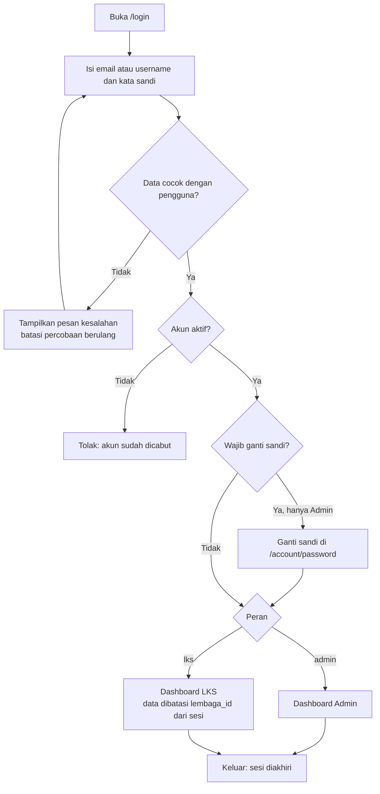

### 6.2 Pendaftaran LKS (UC-02 dan UC-10)

Status yang disimpan: `Menunggu Verifikasi`, `Disetujui` (ditampilkan sebagai **Diterima**), dan `Ditolak`. Keputusan bersifat final.

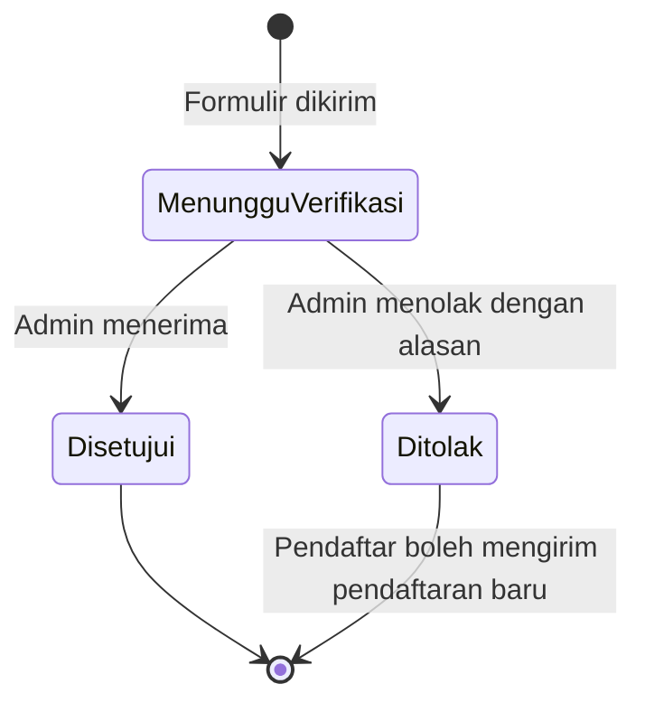

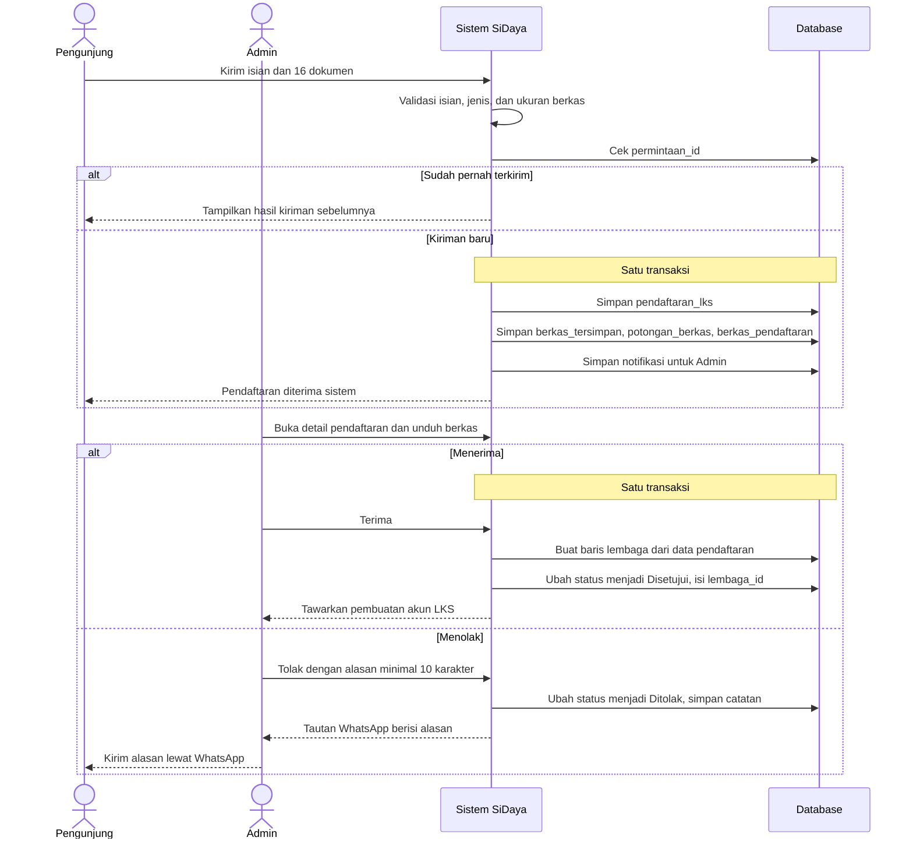

Saat diterima, data disalin ke `lembaga`:

| `pendaftaran_lks` | `lembaga` |
| --- | --- |
| `nama_lembaga` | `nama` |
| `nama_ketua` | `ketua` |
| `whatsapp` | `kontak` |
| `nomor_izin` | `legalitas` |
| Tanggal keputusan | `terdaftar_sejak` |

### 6.3 Akun LKS (UC-11)

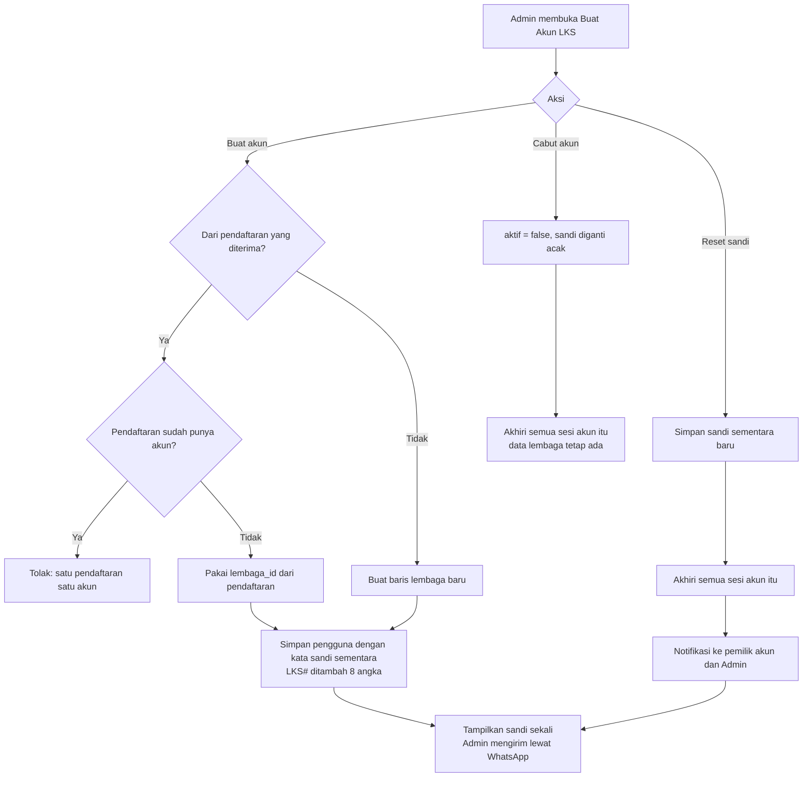

LKS tidak mengganti sandi sendiri. Bila lupa, LKS meminta reset ke Admin. Bila Admin lupa, pemegang akses server menjalankan perintah Artisan pemulihan, dan `wajib_ganti_sandi` menjadi `true`.

### 6.4 Profil lembaga, pengurus, dan klien (UC-05, UC-06, UC-07)

Ketiganya memakai pola yang sama. Data disimpan langsung tanpa persetujuan Admin, dan Admin hanya membaca (UC-12).

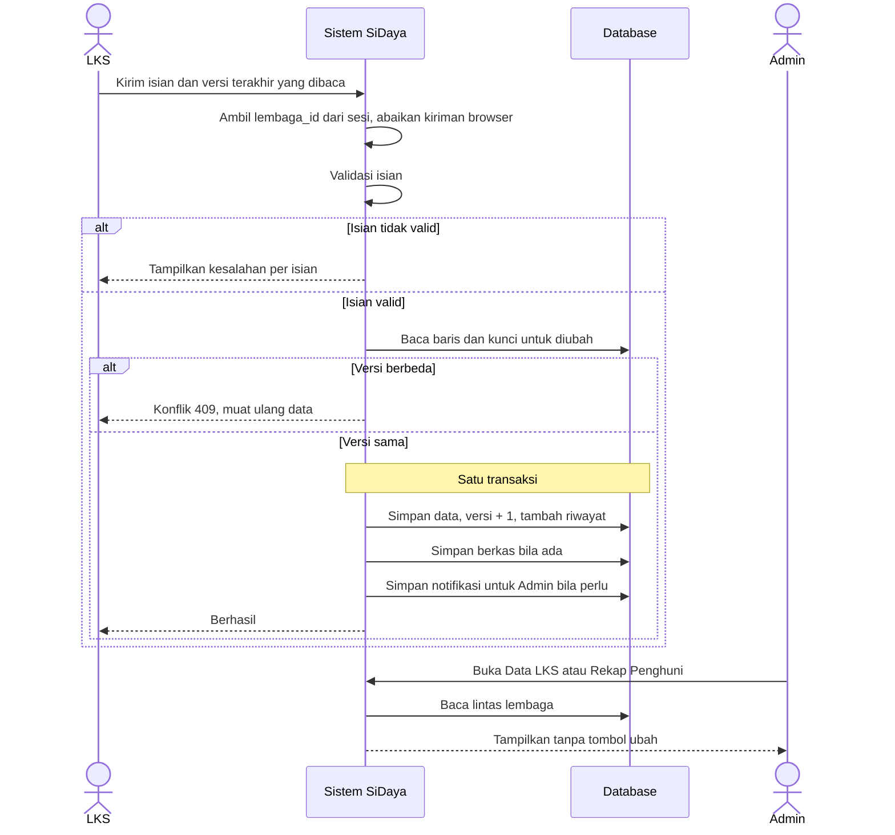

### 6.5 Laporan semester (UC-08 dan UC-13)

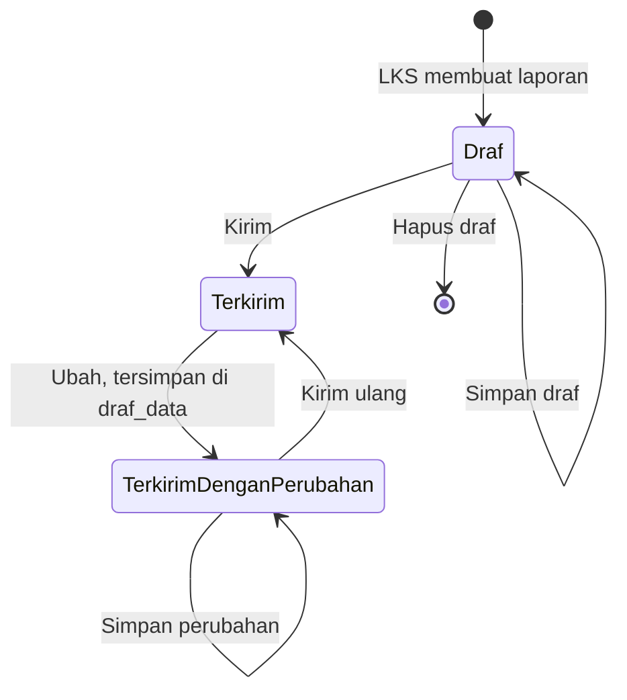

`TerkirimDenganPerubahan` bukan nilai kolom. Statusnya tetap `Terkirim`, dan keadaan ini berarti `draf_data` terisi.

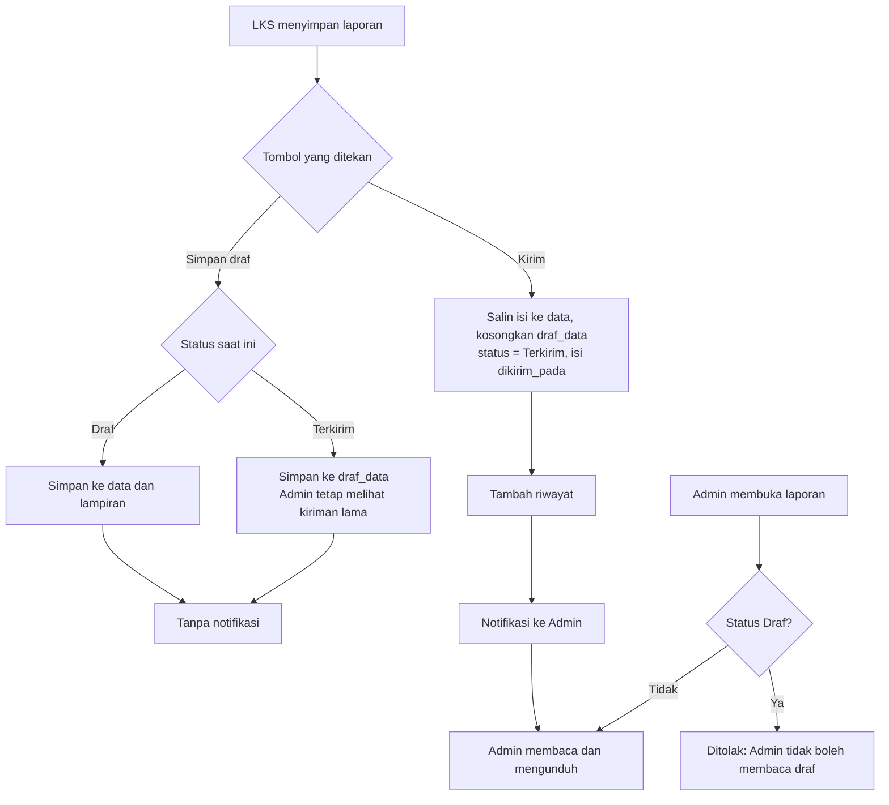

### 6.6 Surat (UC-09)

Kolom `arah` bernilai tetap. Sebutan surat masuk atau keluar ditentukan saat ditampilkan, sesuai peran pembacanya.

| `arah` | Tampil di LKS | Tampil di Admin | Pihak yang mengisi `dibaca_pada` |
| --- | --- | --- | --- |
| `dinas_ke_lks` | Surat masuk | Surat keluar | LKS |
| `lks_ke_dinas` | Surat keluar | Surat masuk | Admin |

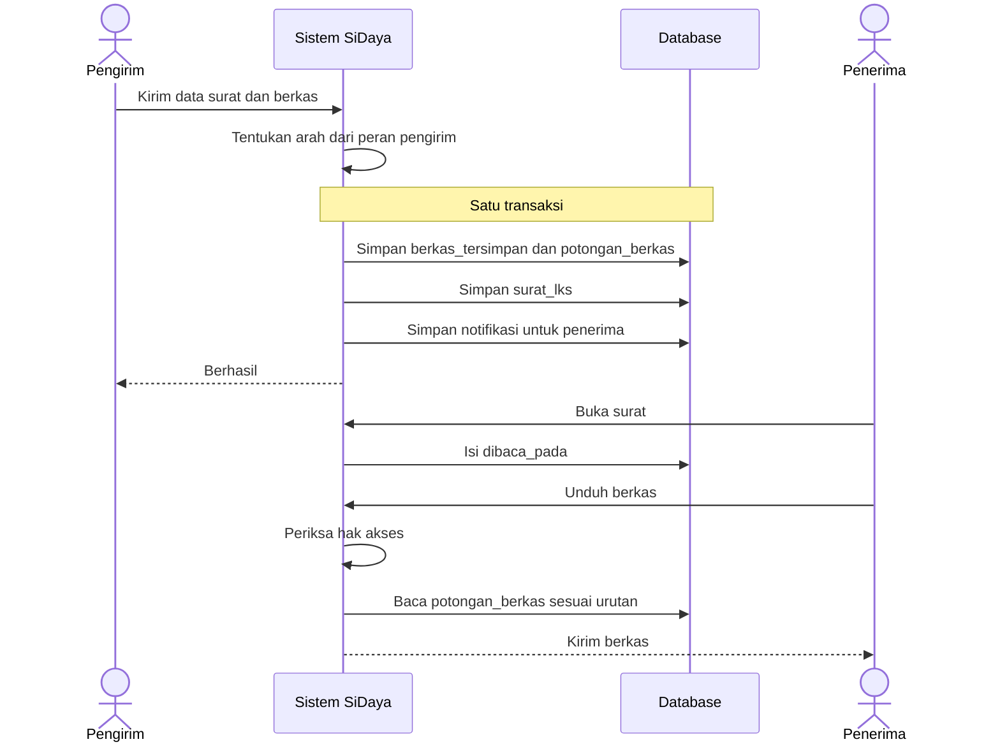

Surat Dinas ke LKS bersifat satu arah, tidak membuat kewajiban membalas atau antrean.

### 6.7 Isi landing page (UC-01 dan UC-14)

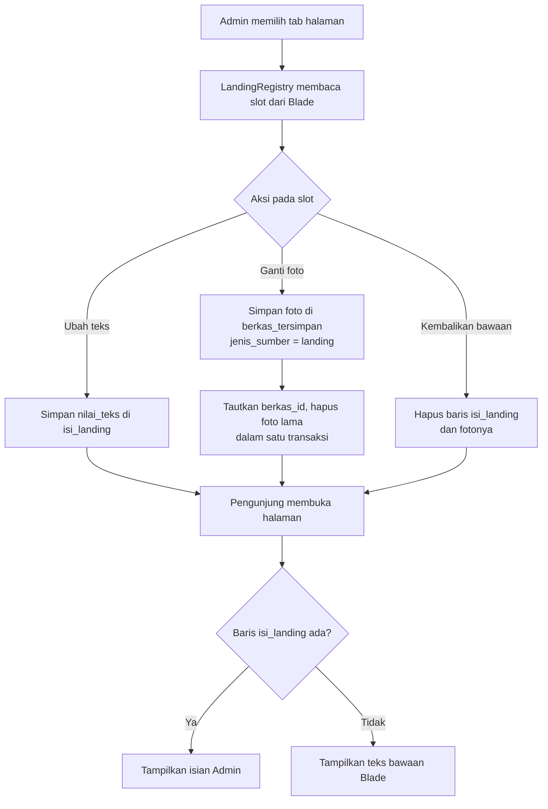

### 6.8 Penyimpanan dan unduh berkas

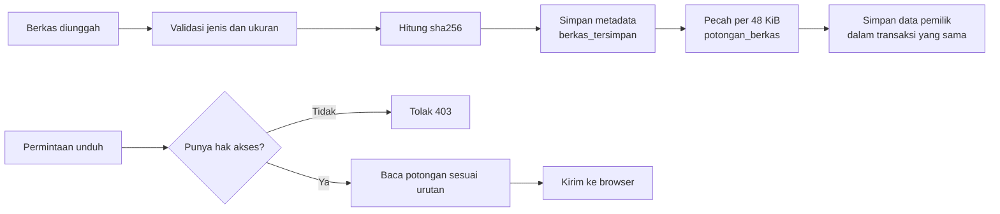

### 6.9 Peristiwa yang membuat notifikasi

| Peristiwa | Penerima |
| --- | --- |
| Pendaftaran LKS baru masuk | Admin |
| Laporan dikirim atau dikirim ulang | Admin |
| LKS mengirim surat | Admin |
| Dinas mengirim surat | LKS terkait |
| Klien ditambahkan, profil lembaga diperbarui | Admin |
| Kata sandi direset | Pemilik akun dan Admin yang mereset |

Menyimpan draf tidak membuat notifikasi. Notifikasi ditulis dalam transaksi yang sama dengan perubahan datanya.

## 7. Dampak nama Indonesia pada Laravel

| Bagian | Yang perlu dilakukan |
| --- | --- |
| Semua model | Tetapkan `protected $table`. Kolom waktu diatur lewat `const CREATED_AT = 'dibuat_pada'` dan `const UPDATED_AT = 'diperbarui_pada'`, sebaiknya di satu model dasar. |
| `pengguna` | Buat model `Pengguna`, daftarkan di `config/auth.php`, dan isi `getAuthPasswordName()` dengan `kata_sandi`. Saat memanggil `Auth::attempt()`, kunci kredensial tetap `password`. |
| `notifikasi` | Buat turunan `DatabaseNotification` dengan `$table = 'notifikasi'`, lalu timpa relasi `notifications()` di `Pengguna`. Kolom tetap bawaan karena `DatabaseChannel` menulis ke nama kolom itu. |
| `sesi` | Atur `SESSION_DRIVER=database` dan `SESSION_TABLE=sesi`. Kolom tetap bawaan karena handler sesi Laravel menulis ke nama kolom itu. |
| `migrations` | Tetap memakai nama bawaan karena hanya catatan milik framework. |
| Blade | Tetap membaca kunci Inggris seperti `organization_name` dan `organizationId`. `App\Support\Data` memetakan kolom Indonesia ke kunci itu. |
| Formulir publik | Nama isian seperti `lks-nama` tetap. Pemetaannya ada di bagian 5.3. |

## 8. Perbedaan dari skema sumber

| Perubahan | Alasan |
| --- | --- |
| `pillar` dan `period_type` dihapus | Hanya ada LKS, dan periodenya selalu semester |
| `users.district`, `users.village` dihapus | Hanya dipakai PSM |
| `partner_registrations.sk_number`, `establishment_date`, `address`, `district`, `village`, `logo`, koordinat dihapus | Formulir LKS tidak mengumpulkannya. Detail Admin Tahap 1 masih membaca `sk_number`, `address`, `district`, dan `village` dari dummy, jadi tampilannya perlu disesuaikan. |
| `partner_registrations.submitted_by` dihapus | Formulirnya publik dan tanpa akun |
| `file_content` serta kolom nama, jenis, dan ukuran berkas dihapus dari tabel surat dan pendaftaran | Isi dan metadata sudah ada di `berkas_tersimpan` |
| `lks_clients.review_note`, `reviewed_by`, `reviewed_at`, `submitted_at`, `approved_data` dihapus | Verifikasi klien sudah pensiun |
| `lks_clients.raw_data` dihapus | Isinya sama dengan kolom biasa |
| `quarterly_reports.reviewed_by`, `reviewed_at` dihapus | Laporan tidak ditinjau |
| `organizations.data` dihapus | Tidak ada isian Tahap 1 yang membutuhkannya |
| `organization_members.data` diganti kolom biasa | Lebih mudah dicari dan divalidasi, dan semua namanya jadi Indonesia |
| Logo dan foto memakai FK `berkas_tersimpan` | Semua berkas tersimpan di satu tempat |
| `type = incoming/outgoing` diganti `arah` | Arti `incoming` di sumber terbalik saat dibaca dari sisi Admin |
| ID lembaga menjadi `uuid` | Sebelumnya campuran string seperti `org-…` |

Dua hal lain yang perlu diperhatikan saat memindahkan kode:

- **Lembaga dibuat saat pendaftaran diterima.** Di kode sumber, kiriman publik menyimpan `organization_id` kosong, tetapi proses menerima langsung memanggil `Organization::findOrFail()` pada kolom itu. Dari pembacaan kode, penerimaan pendaftaran publik tampaknya akan gagal, jadi jangan menyalin bagian ini apa adanya. Perilaku ini belum diuji dengan menjalankan project sumber.
- **Nilai semester.** Data dummy memakai `quarter` 1 dan 3, sedangkan sumber memakai 1 dan 2. Di tabel baru nilainya hanya 1 dan 2.

## 9. Keputusan yang dipakai

Implementasi memakai pilihan berikut.

| No | Keputusan | Pilihan |
| --- | --- | --- |
| 1 | Nama database | `sidaya` dan `sidaya_uji` |
| 2 | Kolom `notifikasi` dan `sesi` tetap bawaan Laravel | Ya. Mengubahnya berarti menulis ulang channel notifikasi dan handler sesi. |
| 3 | `pengurus_lks` memakai kolom biasa, bukan JSON seperti sumber | Ya |
| 4 | `preferensi_notifikasi` ditambahkan | Ya. Halaman Pengaturan Akun punya pilihan ini, sedangkan `app/` di sumber tidak menyimpannya di server. |
| 5 | Admin bisa membuat akun LKS tanpa pendaftaran | Ya, sama seperti sumber |

## 10. Urutan migrasi

Urutan ini mengikuti ketergantungan FK. Beberapa FK ditambahkan belakangan karena tabelnya saling merujuk.

1. `lembaga`, tanpa FK `logo_berkas_id`
2. `pengguna`, tanpa FK `pendaftaran_id`, lalu `sesi`
3. `berkas_tersimpan` dan `potongan_berkas`
4. Tambah FK `lembaga.logo_berkas_id`
5. `pendaftaran_lks` dan `berkas_pendaftaran`
6. Tambah FK `pengguna.pendaftaran_id`
7. `pengurus_lks`
8. `klien_lks`
9. `laporan_semester`
10. `surat_lks`
11. `isi_landing`
12. `notifikasi`
